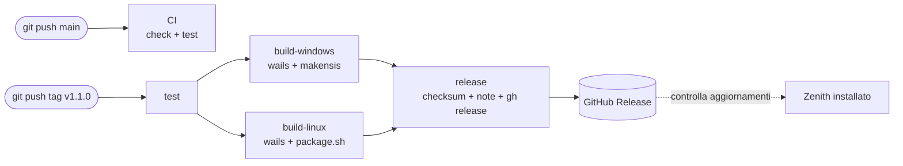

# CI/CD con GitHub Actions — il rilascio di Zenith

Caso pratico della [guida generica alla CI/CD](../README.md): **[Zenith](https://github.com/alexis-82/zenith)**, kanban desktop in Go + Wails + Svelte.

Obiettivo: passare dal rilascio fatto a mano (build in locale, `makensis`, upload dei file sulla pagina della release) a questo:

```bash
git tag -a v1.1.0 -m "Zenith 1.1.0"
git push origin v1.1.0
# ...e dopo ~10 minuti la release su GitHub è pronta, con installer, portable, tar.gz Linux e checksum
```

I due workflow pronti da copiare sono in [`workflows/`](./workflows/):

| File                                                    | Quando parte                    | Cosa fa                                        |
| ------------------------------------------------------- | ------------------------------- | ---------------------------------------------- |
| [`ci.yml`](./workflows/ci.yml)                   | push su `main`, pull request    | test e controlli, nessun file prodotto         |
| [`release.yml`](./workflows/release.yml)         | push di un tag `vX.Y.Z`         | test → build Windows + Linux → GitHub Release  |

---

## 1. I concetti in 5 minuti

### CI, CD e CD

| Sigla                       | Significato                                                                 | In Zenith                                    |
| --------------------------- | --------------------------------------------------------------------------- | -------------------------------------------- |
| **CI** — Continuous Integration | Ogni modifica viene compilata e testata in automatico, su una macchina pulita | `ci.yml` a ogni push                     |
| **CD** — Continuous Delivery    | Ogni versione è *pronta* per il rilascio; la decisione di rilasciare è umana | tu crei il tag, la pipeline fa il resto  |
| **CD** — Continuous Deployment  | Ogni modifica che passa i test va in produzione da sola                      | non adatto a un'app desktop              |

Per un'app desktop ha senso la **Continuous Delivery**: sei tu a decidere *quando* esce una versione (creando il tag), ma *come* esce è tutto automatico e sempre uguale.

### Perché automatizzare

- **Ripetibile**: la build parte sempre da zero su una macchina pulita, niente "sul mio PC funziona".
- **Niente passaggi dimenticati**: versione nel binario, versione nell'installer, nomi dei file, checksum.
- **I test sono un cancello**: se un test fallisce la release non viene creata.
- **Build multi-OS**: Wails usa cgo su Linux, quindi non si può cross-compilare comodamente da Windows. Con la CI ogni OS si builda sulla sua macchina, in parallelo.

### Il vocabolario di GitHub Actions

```
workflow (file .yml in .github/workflows/)
 └── on: trigger         → quando parte (push, tag, PR, manuale, cron)
 └── jobs:
      ├── job "test"     → gira su un runner (VM nuova: ubuntu, windows, macos)
      │    └── steps     → comandi (run:) o azioni riusabili (uses:)
      ├── job "build"    → needs: test  → parte solo se "test" è verde
      └── job "release"
```

| Termine        | Cos'è                                                                                       |
| -------------- | ------------------------------------------------------------------------------------------- |
| **Workflow**   | Un file YAML in `.github/workflows/`. Un repo può averne quanti vuoi.                      |
| **Trigger**    | L'evento che avvia il workflow (`on:`).                                                     |
| **Runner**     | La VM che esegue un job. Quelle di GitHub sono gratuite e illimitate per i repo pubblici.   |
| **Job**        | Gruppo di step sullo stesso runner. Job diversi girano in parallelo, salvo `needs:`.        |
| **Step**       | Un comando shell (`run:`) o un'action (`uses: actions/checkout@v7`).                        |
| **Action**     | Step riutilizzabile pubblicato da altri (checkout, setup-go, upload-artifact…).             |
| **Artifact**   | File salvato da un job per passarlo a un altro job (le VM non condividono il disco).       |
| **`GITHUB_TOKEN`** | Token creato da GitHub per ogni run: permette al workflow di creare la release senza configurare segreti. |

---

## 2. Quali strumenti usare

Nella ricerca escono tanti nomi che fanno cose diverse. Facciamo ordine.

| Strumento              | Categoria                 | Ha senso per Zenith?                                                                        |
| ---------------------- | ------------------------- | ------------------------------------------------------------------------------------------- |
| **GitHub Actions**     | CI/CD                     | ✅ **Scelto.** Il codice e le release sono già su GitHub, runner Windows e Linux gratis per i repo pubblici, la release si crea con il token incluso. |
| Buddy                  | CI/CD (SaaS, editor visuale) | Funziona, ma è un servizio esterno da collegare al repo; piano gratuito limitato. Utile se preferisci configurare la pipeline con il mouse. |
| GitLab CI              | CI/CD                     | Ottimo, ma ha senso se il codice sta su GitLab.                                             |
| Jenkins                | CI/CD self-hosted         | Server da installare e mantenere: troppo per iniziare.                                      |
| CircleCI / Azure Pipelines | CI/CD (SaaS)          | Alternative valide, nessun vantaggio rispetto ad Actions per un repo su GitHub.             |
| GoReleaser             | Tool di release per Go    | Ottimo per CLI Go pure. Per Wails (cgo + frontend + installer NSIS) si complica: meglio comandi espliciti. |
| release-please / semantic-release | Automazione versioni | Calcolano il numero di versione dai messaggi di commit. Passo successivo, vedi §9.   |

**Stack di questa guida**: Git + GitHub Actions + `gh` (GitHub CLI, già presente sui runner). Nient'altro da installare o pagare.

---

## 3. Cosa deve produrre la pipeline

Prima di scrivere YAML bisogna sapere *cosa* rilasciare. In Zenith i nomi dei file non sono un dettaglio: l'**aggiornamento automatico** dell'app (`internal/update/update.go`, funzione `PickAsset`) cerca nella release un file con un nome preciso.

| File nella release                     | Prodotto da                                  | Usato da                                    |
| -------------------------------------- | -------------------------------------------- | ------------------------------------------- |
| `Zenith-X.Y.Z-amd64-installer.exe`     | `wails build` + `makensis` (`zenith.nsi`)    | utenti Windows e updater Windows            |
| `zenith-X.Y.Z-amd64-portable.exe`      | `wails build` (copia di `zenith.exe`)        | chi non vuole installare                    |
| `zenith-linux-amd64.tar.gz`            | `wails build -tags webkit2_41` + `package.sh`| `install.sh`, `zenith-update.sh`, updater Linux |
| `SHA256SUMS.txt`                       | `sha256sum` nel job di release               | verifica manuale dei download               |

E la versione va iniettata in **due** posti, entrambi presi dal tag:

- nel binario: `-ldflags "-X main.version=v1.2.0"` (vedi `main.go`; senza, la versione è `dev` e l'updater non propone mai aggiornamenti);
- nell'installer: `makensis /DVERSION=1.2.0` (nome del file e "App installate" di Windows).

---

## 4. Versionamento: SemVer e tag

La pipeline è guidata dai **tag Git**. Il formato è [Semantic Versioning](https://semver.org/lang/it/) con la `v` davanti, lo stesso che si aspetta l'updater:

```
v MAJOR . MINOR . PATCH
   1   .   2   .   0
```

| Incrementa | Quando                                         | Esempio            |
| ---------- | ---------------------------------------------- | ------------------ |
| PATCH      | correzioni di bug, nessuna novità visibile      | `v1.0.0 → v1.0.1`  |
| MINOR      | nuove funzionalità compatibili                  | `v1.0.1 → v1.1.0`  |
| MAJOR      | cambi incompatibili (es. nuovo formato del JSON) | `v1.1.0 → v2.0.0` |

**Messaggi di commit**: la pipeline costruisce le note di rilascio dai titoli dei commit, e Zenith le mostra all'utente nella finestra "aggiornamento disponibile". Conviene quindi scriverli leggibili, meglio se in stile [Conventional Commits](https://www.conventionalcommits.org/it/) (già usato in parte nel repo):

```
feat: esportazione del progetto in Markdown
fix: il drag & drop non salvava l'ordine dei task
docs: istruzioni di installazione su Fedora
```

Messaggi come `README.md` o `icons` finiscono pari pari nelle note: meglio evitarli sui commit che vanno in release.

---

## 5. La pipeline



### 5.1 `ci.yml` — l'integrazione continua

[`zenith/workflows/ci.yml`](./workflows/ci.yml) parte a ogni push su `main` e a ogni pull request. Due job in parallelo:

**`frontend`** — `npm ci` → `npm run check` (svelte-check, errori TypeScript) → `npm test` (vitest).

**`go`** — `go vet` + `go test` su tutti i pacchetti. Due dettagli non ovvi:

```yaml
# 1. Wails su Linux usa cgo con GTK3 e WebKitGTK 4.1: senza le librerie
#    di sviluppo il pacchetto main non compila nemmeno per i test.
- run: sudo apt-get install -y libgtk-3-dev libwebkit2gtk-4.1-dev

# 2. main.go contiene //go:embed all:frontend/dist, e frontend/dist non è
#    versionato: va buildato il frontend prima di go test.
- working-directory: frontend
  run: npm ci && npm run build

- run: go test -tags webkit2_41 ./...
```

Altri elementi da riconoscere:

```yaml
concurrency:              # un nuovo push annulla la run vecchia ancora in corso
  group: ci-${{ github.ref }}
  cancel-in-progress: true

permissions:
  contents: read          # principio del minimo privilegio: la CI legge e basta

- uses: actions/setup-go@v7
  with:
    go-version-file: go.mod   # la versione di Go la decide go.mod, non il workflow

- uses: actions/setup-node@v7
  with:
    cache: npm                # node_modules scaricati una volta e riusati tra le run
```

### 5.2 `release.yml` — dal tag alla release

[`zenith/workflows/release.yml`](./workflows/release.yml) parte **solo** quando arriva un tag che rispetta il pattern:

```yaml
on:
  push:
    tags: ["v*.*.*"]
```

Dentro il workflow il nome del tag è disponibile come `${{ github.ref_name }}` (o `$GITHUB_REF_NAME` nella shell), es. `v1.1.0`.

**Job 1 — `test`.** Ripete i controlli della CI. Sembra ridondante, ma un tag si può creare su qualunque commit, anche uno che non è mai passato dalla CI.

**Job 2a — `build-windows`** su `windows-latest`, parte solo se `test` è verde (`needs: test`):

```powershell
$tag = "${{ github.ref_name }}"     # v1.1.0  → nel binario (formato dell'updater)
$ver = $tag.TrimStart("v")          # 1.1.0   → nell'installer (formato x.y.z di NSIS)
wails build -ldflags "-X main.version=$tag"
& "C:\Program Files (x86)\NSIS\makensis.exe" /DVERSION=$ver build\windows\installer\zenith.nsi
Copy-Item build\bin\zenith.exe "build\bin\zenith-$ver-amd64-portable.exe"
```

Wails CLI e NSIS vengono installati nello step precedente (`go install …wails@v2.16.0`, `choco install nsis`). La versione di Wails CLI è fissata uguale a quella in `go.mod`: quando aggiorni Wails, aggiorna entrambe.

**Job 2b — `build-linux`** su `ubuntu-24.04`, in parallelo al 2a:

```bash
wails build -tags webkit2_41 -ldflags "-X main.version=${{ github.ref_name }}"
sh build/linux/package.sh     # → build/bin/zenith-linux-amd64.tar.gz
```

Si usa `ubuntu-24.04` e non `ubuntu-latest` perché il tag `webkit2_41` richiede WebKitGTK 4.1: fissare la versione evita sorprese quando GitHub sposta `latest`.

Entrambi i job finiscono con `actions/upload-artifact`: i file prodotti vengono salvati, perché ogni job gira su una VM diversa e alla fine viene distrutta. `if-no-files-found: error` fa fallire il job se un nome cambia e il file non viene trovato, invece di pubblicare una release incompleta.

**Job 3 — `release`**, parte quando entrambe le build sono verdi:

```yaml
permissions:
  contents: write      # solo questo job può scrivere sul repo
```

1. `actions/download-artifact` con `merge-multiple: true` mette tutti i file in `dist/`.
2. `sha256sum * > SHA256SUMS.txt` — checksum di tutti i file. In più GitHub calcola da solo il digest SHA-256 di ogni file caricato, ed è quello che l'updater di Zenith verifica dopo il download.
3. **Note di rilascio**: elenco dei commit dal tag precedente a quello attuale:
   ```bash
   prev=$(git describe --tags --abbrev=0 "${GITHUB_REF_NAME}^" 2>/dev/null || true)
   git log --no-merges --pretty='- %s' "${prev:+$prev..}$GITHUB_REF_NAME"
   ```
   Per questo il checkout usa `fetch-depth: 0`: di default scarica solo l'ultimo commit, senza storia né tag.
4. `gh release create` crea la release, allega i file e la marca come *Latest*. `--verify-tag` evita che `gh` crei un tag nuovo se qualcosa non torna. Il token è `${{ github.token }}`: nessun segreto da configurare.

---

## 6. Installazione nel repo di Zenith

Una volta sola.

```bash
cd zenith
mkdir -p .github/workflows
cp ../guide_devops/cicd/zenith/workflows/ci.yml      .github/workflows/
cp ../guide_devops/cicd/zenith/workflows/release.yml .github/workflows/

# applica prima la correzione del §3 (nome dell'installer), poi:
git add .github/workflows internal/update build/windows/installer/zenith.nsi
git commit -m "ci: pipeline di CI e release con GitHub Actions"
git push
```

Dopo il push, nella scheda **Actions** del repo compare la run di **CI**. Se è verde, la pipeline di base funziona.

Impostazioni da controllare su GitHub (**Settings → Actions → General**):

- *Actions permissions*: "Allow all actions and reusable workflows" (default).
- *Workflow permissions*: può restare "Read repository contents" — il job `release` chiede da sé `contents: write`.

---

## 7. Procedura di rilascio

Ogni volta che vuoi pubblicare una versione.

```bash
# 1. Parti da main aggiornato e con la CI verde
git switch main
git pull
gh run list --workflow ci.yml --limit 1      # oppure guarda la scheda Actions

# 2. Scegli il numero di versione (§4) e guarda cosa finirà nelle note
git log --oneline v1.0.0..HEAD

# 3. Crea il tag annotato e pushalo: è questo che avvia la release
git tag -a v1.1.0 -m "Zenith 1.1.0"
git push origin v1.1.0

# 4. Segui la pipeline
gh run watch                                  # oppure scheda Actions → Release

# 5. Controlla il risultato
gh release view v1.1.0
```

**Con GitKraken** il passo 3 diventa: tasto destro sul commit → *Create annotated tag here* → nome `v1.1.0` → tasto destro sul tag nel pannello a sinistra → *Push v1.1.0 to origin*. Il resto è identico: GitKraken crea il tag, GitHub Actions fa la release.

**Verifica finale**, la prova che conta: apri la versione precedente di Zenith e premi **Impostazioni → Controlla aggiornamenti**. Deve proporti la nuova versione con le note di rilascio e installarla.

---

## 8. Quando qualcosa va storto

| Problema                                       | Soluzione                                                                                   |
| ---------------------------------------------- | ------------------------------------------------------------------------------------------- |
| Un job fallisce per un errore temporaneo (rete, apt) | Scheda Actions → run → **Re-run failed jobs**. Non serve rifare il tag.             |
| Test rossi dopo il tag                         | Nessuna release creata. Correggi, cancella il tag e ricrealo (sotto).                       |
| Tag sbagliato o release da rifare              | Vedi i comandi sotto.                                                                        |
| `makensis.exe` non trovato                     | Controlla l'output di `choco install nsis`; il percorso di default è `C:\Program Files (x86)\NSIS\`. |
| Linux: `Package webkit2gtk-4.1 was not found`  | Runner diverso da `ubuntu-24.04`, oppure manca `-tags webkit2_41`.                          |
| `pattern all:frontend/dist: no matching files` | Il frontend non è stato buildato prima di `go test`/`go vet`.                               |
| L'updater non propone la nuova versione        | Binario buildato senza `-X main.version` (risulta `dev`), oppure nome dell'asset diverso da quello cercato da `PickAsset` (§3). |

Rifare una release da zero:

```bash
gh release delete v1.1.0 --yes          # cancella la release (e i file allegati)
git push origin :refs/tags/v1.1.0       # cancella il tag su GitHub
git tag -d v1.1.0                       # cancella il tag locale
# correggi, committa, poi ricrea il tag (§7 punto 3)
```

> Cancella e ricrea un tag solo se la release è rimasta pubblica per poco. Se qualcuno può averla già scaricata, è più pulito pubblicare `v1.1.1`.

---

## 9. Passi successivi

In ordine di utilità, quando la base è rodata:

1. **Branch protection** su `main` (Settings → Branches): obbliga la CI verde prima del merge di una pull request.
2. **Dependabot** (`.github/dependabot.yml`): PR automatiche per aggiornare moduli Go, pacchetti npm e le stesse action del workflow.
3. **Firma del codice Windows**: un installer non firmato fa comparire l'avviso SmartScreen. Il certificato va caricato come *secret* del repo e usato con `signtool` nel job Windows.
4. **Linux arm64**: aggiungere un job su runner `ubuntu-24.04-arm` (gratuito per i repo pubblici); `package.sh` produce già `zenith-linux-arm64.tar.gz`.
5. **release-please**: legge i Conventional Commits, apre da solo una PR "release 1.2.0" con changelog e versione calcolata; al merge crea il tag e la pipeline di questa guida parte come sempre.

---

## Riferimenti

- GitHub Actions: <https://docs.github.com/actions>
- Sintassi dei workflow: <https://docs.github.com/actions/reference/workflow-syntax-for-github-actions>
- GitHub CLI `gh release`: <https://cli.github.com/manual/gh_release_create>
- Wails, build e cross-platform: <https://wails.io/docs/guides/crossplatform-build>
- NSIS: <https://nsis.sourceforge.io/Docs/>
- Semantic Versioning: <https://semver.org/lang/it/>
